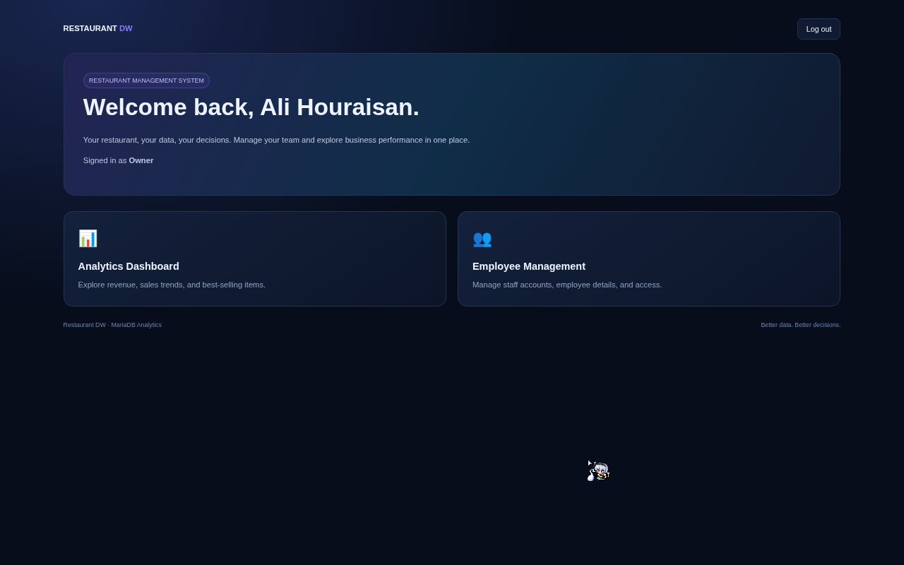
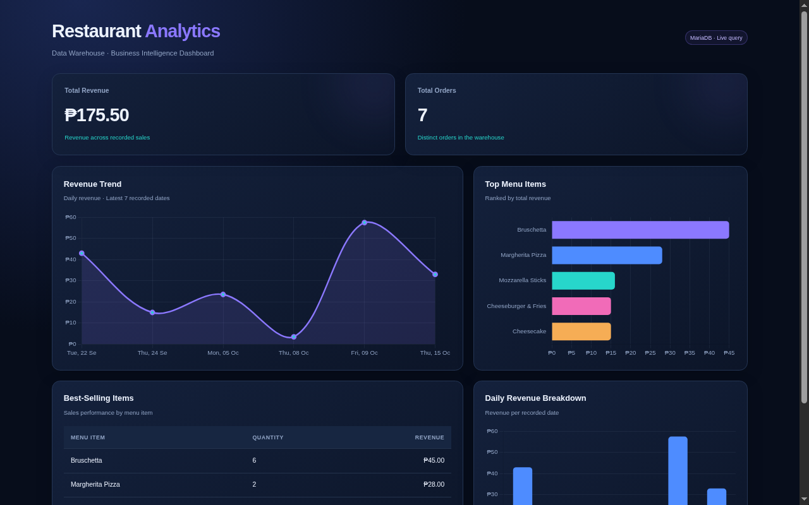

# 💚 Ordering System — Group Koishi 💚

> *"Even if your subconscious can't decide what to eat, Koishi's ordering system is here to take your order without a single thought!"* 👁️✨

<p align="center">
  
  &nbsp;&nbsp;&nbsp;&nbsp;
  
</p>


---

## 🌸 Table of Contents
- [About the Project](#-about-the-project)
- [System Architecture & Tech Stack](#-system-architecture--tech-stack)
- [Project Structure](#-project-structure)
- [Getting Started](#-getting-started)
- [Dashboards & Visualizations](#-dashboards--visualizations)
- [System Progress Pictures](#-system-progress-pictures)

---

## 🍮 About the Project

Welcome to the **Restaurant Ordering System** repository maintained by **Group Koishi**! 
Inspired by the carefree and unpredictable **Koishi Komeiji** from *Touhou Project*, this application seamlessly handles restaurant orders, operational databases, ETL pipelines, data warehousing (Star Schema), and interactive web dashboards! 


---

## 🍄 System Architecture & Tech Stack

- **Backend / Web App:** Python (Flask, `app.py`)
- **Database & ETL:** MariaDB / SQL (`sql_file/`, `pytho/etl_manager.py`, `dw_manager.py`)
- **Frontend UI:** HTML5, CSS3 (`templates/`, `static/dashboard.css`)
- **Analytics & Dashboards:** Jupyter Notebooks (`pytho/Task 9 – Visualization Dashboard.ipynb`)

---

## 📂 Project Structure

```text
ordering-system/
├── app.py                      # Main Flask web application
├── pytho/                      # Python ETL, DW managers & Jupyter notebooks
│   ├── db_generator.py
│   ├── dw_manager.py
│   ├── etl_manager.py
│   └── Task 9 – Visualization Dashboard.ipynb
├── sql_file/                   # SQL schemas & ETL scripts
│   ├── 1-Operational-Database-Restaurant-Ordering-System (1).sql
│   ├── 2-ETL-Restaurant-Ordering-System.sql
│   ├── DW.sql
│   └── etl.sql
├── templates/                  # HTML UI templates (dashboards, order forms, etc.)
│   ├── dashboard.html
│   ├── index.html
│   ├── login.html
│   ├── operational_dashboard.html
│   ├── order_form.html
│   └── staff.html
└── static/                     # Stylesheets (dashboard.css)
```

 *(Oops, Koishi closed her eyes and wandered into the directory structure!)*

---

## 🚀 Getting Started

1. **Clone the repository:**
   ```bash
   git clone https://github.com/BSDSA-ISU/ordering-system-group-koishi.git
   cd ordering-system
   ```

2. **Set up virtual environment & dependencies:**
   ```bash
   python -m venv .venv
   source .venv/bin/activate  # On Windows: .venv\Scripts\activate
   pip install -r pytho/pyproject.toml
   ```

3. **Run the Flask App:**
   ```bash
   python app.py
   ```

---

## 📊 Dashboards & Visualizations

Explore our stunning operational dashboards and analytical notebooks:
- **Operational Dashboard:** `templates/operational_dashboard.html`
- **Visualization Notebook:** `pytho/Task 9 – Visualization Dashboard.ipynb`


---

## 🖼️ System Progress Pictures

Here is a sneak peek at our system interfaces and dashboards:

### Progress View 1


### Progress View 2


---

<p align="center">
  <b>Made with 💚 and subconscious magic by Group Koishi 👁️🌹</b>
  <br>
  
</p>
